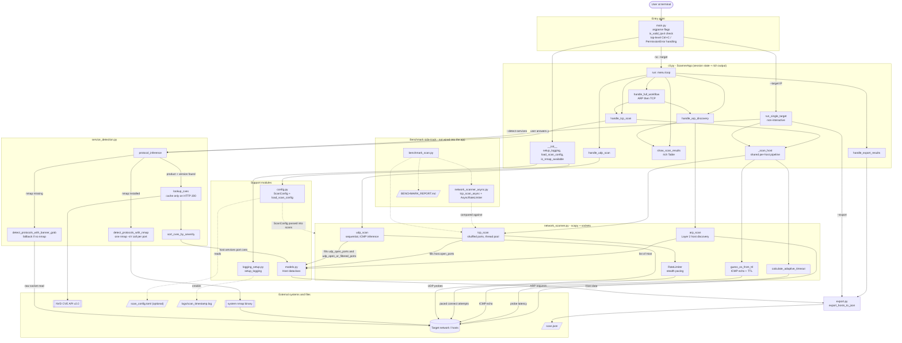

# Network Security Scanner

A Python network reconnaissance tool: ARP host discovery, threaded TCP/UDP port
scanning, nmap-based service/version detection, and automatic NVD CVE lookup for
whatever services are found — with JSON export for the results.

Built as a portfolio project to demonstrate practical security tooling and
systems-level Python (raw sockets, concurrency, rate limiting) rather than just
scripting `nmap` calls.

## Features

- **ARP host discovery** on a local subnet (scapy), with VM-test and live-network modes
- **Threaded TCP port scanning** with shuffled scan order (avoids naive sequential-scan
  detection) and a stealth-oriented rate limiter that paces individual connection
  attempts, not just batches
- **UDP port scanning** with proper ICMP-based state inference (`open` /
  `closed` / `filtered` / `open|filtered`)
- **Adaptive timeout calculation** and best-effort OS fingerprinting via TTL/ICMP
- **Service/version detection** via `nmap -sV`, falling back to raw banner-grabbing
  if `nmap` isn't installed
- **Automatic CVE lookup** against the NVD REST API for any product/version nmap
  identifies, with CVSS-based severity sorting and color-coded output
- **JSON export** of a scan's full results (open ports, services, CVEs)
- Both an **interactive menu** and a **non-interactive CLI mode** for scripting
  (`--target`, `--ports`, `--detect-services`, `--export`, `--rate`)
- A persistent per-session audit log (`logs/scan_<timestamp>.log`), separate from
  the interactive console output
- An optional `scan_config.toml` for tuning scan behavior without touching code

## Why this project

Most "port scanner" portfolio projects are a loop around `socket.connect_ex`. This
one tries to behave like a tool you'd actually use during a pentest engagement:

- Scans are rate-limited and port order is shuffled by default — quiet is the
  default, not an afterthought
- UDP scanning had to be redesigned from a naive `ThreadPoolExecutor` approach after
  two real, reproducible bugs surfaced during testing: `scapy`'s `sr1()` is not
  thread-safe (concurrent calls cross-matched replies between threads and produced
  false positives — a definitely-closed port reported as open), and
  `ThreadPoolExecutor`'s task pre-dequeuing made Ctrl+C hang for 100+ seconds against
  an unresponsive host. UDP scanning is now a plain sequential loop as a result.
- A sync (threaded) vs. async (`asyncio`) TCP scanner were both implemented and
  benchmarked head-to-head (see [BENCHMARK_REPORT.md](BENCHMARK_REPORT.md)) before
  deciding which one to actually wire into the CLI.
- CVE lookups only cache *successful* NVD responses — an early version cached
  rate-limited/failed lookups the same as genuinely-empty ones, which would have
  permanently hidden real CVEs for the rest of a session after one transient 429.

## Requirements

- Python 3.11+ (uses `tomllib` from the standard library)
- [Nmap](https://nmap.org/download.html) installed system-wide and on `PATH`
  (separate from the `python-nmap` pip package, which is just a wrapper around it).
  Without it, service detection falls back to banner-grabbing and CVE lookups are
  skipped.
- Root/Administrator privileges (raw ARP/ICMP/UDP sockets)
- Npcap (Windows) or equivalent packet-capture driver for scapy

## Installation

```bash
git clone https://github.com/Nadavsim/Network-Security-Scanner.git
cd Network-Security-Scanner
pip install -r requirements.txt
```

## Usage

Interactive menu (ARP discovery, host selection, TCP/UDP scans, export):

```bash
python main.py
```

Non-interactive, single-target mode — skips ARP discovery and the menu entirely:

```bash
python main.py --target 192.168.1.16 --ports 1000 --detect-services --export scan.json
```

Run `python main.py --help` for the full flag list. Note: `--ports`, `--interface`,
`--detect-services`, `--export`, and `--rate` all require `--target`; without it,
the tool falls back to the interactive menu with a warning.

Optional tuning via `scan_config.toml` in the working directory (copy
[scan_config.example.toml](scan_config.example.toml) to get started) — everything
except the target itself (chosen via `--target` or the interactive menu) can be
overridden there.

## Testing

```bash
pytest
```

112+ tests covering the scanning logic, config loading, CVE lookup/caching, export,
logging setup, and the CLI's host-scan pipeline — network calls are mocked
throughout, so the suite doesn't require root or a live network.

Benchmark the threaded vs. asyncio TCP scanners against each other:

```bash
python benchmark_scan.py --quick   # fast sanity check
python benchmark_scan.py           # full benchmark, a few minutes
```

## Architecture

How the modules talk to each other, from the entry point down to the network, nmap,
and the NVD API. Dotted lines are side relationships (config/log files, and the
benchmark track that isn't wired into the app).



## Project structure

| File | Purpose |
|---|---|
| `main.py` | Entry point, CLI argument parsing, top-level error handling |
| `cli.py` | `ScannerApp` — interactive menu loop and session state |
| `config.py` | `ScanConfig` dataclass and `scan_config.toml` loading |
| `network_scanner.py` | ARP discovery, TCP/UDP port scanning, rate limiting, OS fingerprinting |
| `network_scanner_async.py` | Benchmarked `asyncio` TCP scanner (kept for comparison, not wired into the CLI) |
| `service_detection.py` | nmap/banner-grab service detection, NVD CVE lookup |
| `export.py` | JSON export of scan results |
| `logging_setup.py` | Persistent per-session audit log setup |
| `models.py` | `Host` dataclass |
| `benchmark_scan.py` | Standalone sync-vs-async scanner benchmark harness |
| `tests/` | pytest suite |

## Disclaimer

For use only against systems you own or have explicit authorization to test.
Unauthorized scanning of networks or hosts may be illegal.

## Author

Nadav Simchai
